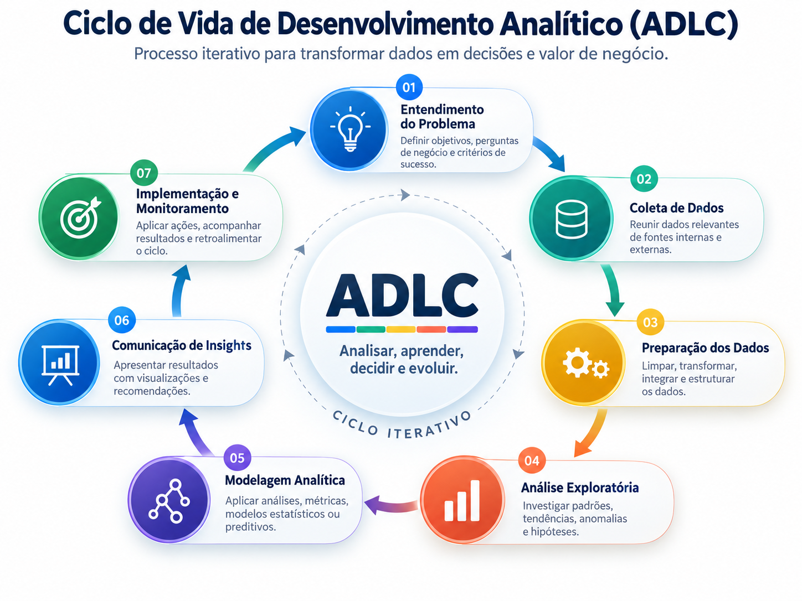

# DataOps

Práticas para desenvolver, revisar e operar ativos de dados com confiança. Escale o processo ao risco: uma análise pontual precisa de rastreabilidade e validação; um pipeline recorrente precisa também de recuperação e monitoramento.

- [Git e versionamento](git-e-versionamento.md).
- [CI/CD para dados](ci-cd.md).
- [Testes e automação](testes-e-automacao.md).
- [Monitoramento](monitoramento.md).
- [Documentação](documentacao.md).

O ciclo de referência envolve planejar, desenvolver, testar, implantar, operar/observar e descobrir/analisar. Consulte o [PDF original ADLC](../referencias/materiais/the-analytics-development-lifecycle.pdf). A imagem fornecida foi preservada:

Este diretório não configura automações. Para detalhes dbt e evolução com Airflow, veja [deploy e monitoramento](../../analytics-engineering/guias/deploy-ci-cd-monitoramento.md).
